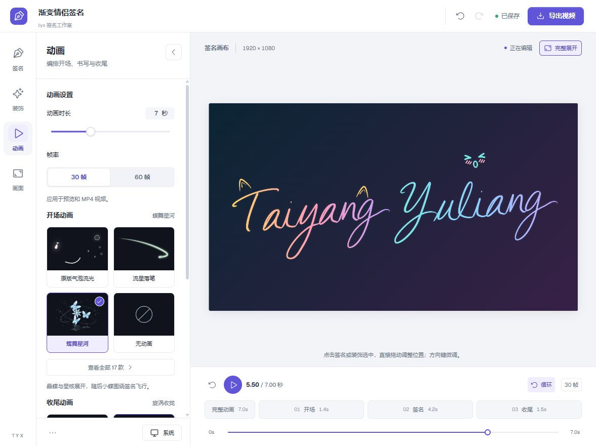
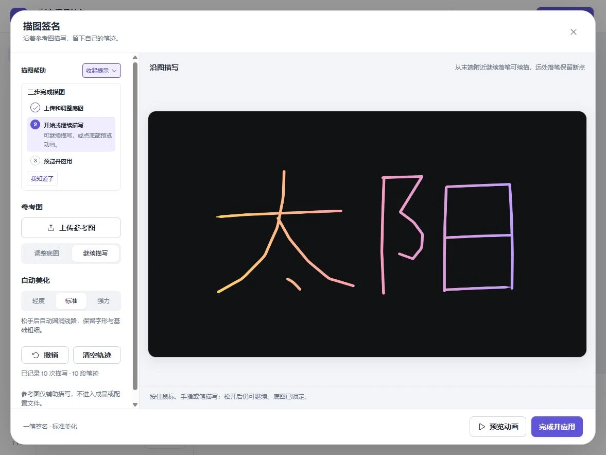

<div align="center">

  <h1>tyx · 签名动画</h1>
  <p><strong>把名字，写成自己的样子。</strong></p>
  <p>输入英文或拼音生成连笔，或描摹自己的手写签名。<br>搭配渐变、装饰与首尾动画，在浏览器里导出 MP4 或透明 GIF。</p>

  <p>
    <a href="https://tangyx527.github.io/tyx-signature/"><strong>立即在线体验 ↗</strong></a>
    &nbsp; · &nbsp;
    <a href="assets/showcase/signature-demo.mp4?raw=true">查看完整演示视频</a>
  </p>

  <p>
    
    
    <a href="LICENSE"></a>
  </p>

  <picture>
    <source media="(prefers-reduced-motion: reduce)" srcset="assets/showcase/signature-poster.webp">
    
  </picture>

  <p><sub>双人渐变签名 · 7 秒完整动画 · 1080p MP4 真实导出</sub></p>

</div>

## 在画布上直接设计

点击签名或装饰即可选中、拖动；在左侧调整样式，在底部单独预览开场、书写和收尾。



## 你可以做什么

| 想做什么 | 可以这样创作 |
| --- | --- |
| **生成名字，或保留自己的笔迹** | 英文和拼音使用内置连笔字形；自己的手写签名可上传参考图后描摹，支持续描与三档平滑。单人、双人均可使用。 |
| **调出自己的配色** | 签名与背景分别设置纯色或渐变，自定义 2–5 个颜色、色标位置和方向；双人签名独立配色。 |
| **搭配装饰和动画** | 选择萌宠、爪爪、表情、星座装饰，自由移动构图；16 款开场、2 款收尾独立搭配，也可关闭动画。 |
| **导出可以使用的成品** | MP4 支持配乐和 30 / 60 fps，透明 GIF 可叠加到其他画面；横屏、竖屏、方形均可设计。 |

## 三步完成

1. **写下签名**：输入英文或拼音，或选择“描图签名”留下自己的笔迹。
2. **设计效果**：调整颜色与装饰，拖动构图，选择喜欢的开场和收尾。
3. **导出作品**：点击顶部“导出视频”，选择 MP4 或 GIF，生成后下载。

首次进入可跟随教学引导，随时跳过；在左下角“更多操作 → 教学引导”中可以重新打开。

<details>
<summary><strong>更多效果：单人签名与手写描图</strong></summary>

### 单人签名

<picture>
  <source media="(prefers-reduced-motion: reduce)" srcset="assets/showcase/single-poster.webp">
  
</picture>

5 秒完整动画。[查看单人原画质 MP4](assets/showcase/single-demo.mp4?raw=true)。

### 手写描图



图中为描图示例笔迹。参考图只辅助描写，不进入成品；保存原始轨迹后，仍可继续描写或调整美化。

</details>

<details>
<summary><strong>操作说明与常见问题</strong></summary>

- **调整构图**：完整画布中直接点选、拖动签名或装饰；方向键微调，Shift + 方向键加快移动，也可在面板中输入位置。
- **查看动画**：点击预览图卡选择首尾动画；底部支持完整或分段播放、循环和进度定位，完整展开便于静态设计。
- **撤销修改**：顶部支持撤销 / 重做，输入框内保留文字编辑的原生撤销。
- **腾出画布空间**：收起设置栏后保留图标导航，点击图标即可重新展开。界面可选择浅色、深色或跟随系统。
- **保存与迁移**：设计自动保存在当前浏览器。“更多操作”提供配置下载、导入与重置；音乐文件需重新选择。
- **首次描图**：先调整底图位置、缩放与透明度，再开始描写。完成后点击“完成并应用”；参考图重新打开时需再次上传。
- **导出参数**：MP4 为 H.264、1080p，30 / 60 fps 可选，总时长 3–15 秒。GIF 长边 960px、20 fps，支持透明、纯色或渐变背景，无音频。
- **透明边缘**：GIF 采用单层透明，柔光边缘会有所简化；需要配乐时使用 MP4。

设计与视频处理在当前设备完成，无需登录或上传到渲染服务器。

</details>

## 开发与部署

<details>
<summary><strong>本地运行、构建与技术架构</strong></summary>

推荐 Node.js **24 LTS**，项目支持 `>=22.14 <25`。在源码目录执行：

```sh
npm ci
npm start
```

打开终端显示的网址。Windows 可双击 `开始使用.cmd`；macOS 可运行 `sh ./开始使用.command`。

```sh
npm run check   # 类型检查
npm test        # 测试
npm run build  # 构建静态网站
```

构建结果位于 `dist/`，可部署到静态托管平台。使用 GitHub Pages 时，将 Settings → Pages → Source 设为 **GitHub Actions**；推送到 `main` 后自动检查、构建并部署。

<p>
  
  
</p>

| 层次 | 技术与职责 |
| --- | --- |
| 编辑界面 | React + TypeScript 管理输入、双人设置、预览控制与配置保存。 |
| 图形与动画 | Canvas 绘制连笔字形、装饰和首尾动画；预览与导出共用绘制器。 |
| 视频与音频 | 按需加载 Mediabunny，通过 WebCodecs 编码 H.264 MP4，可选 AAC 音轨。 |
| 动图导出 | 按需加载 gifenc，直接编码同一 Canvas 时间轴。 |
| 构建与托管 | Vite + GitHub Pages 提供静态站点，无需视频渲染后端。 |

</details>

<details>
<summary><strong>浏览器兼容性与已验证范围</strong></summary>

MP4 导出需要 **HTTPS** 或本机 **localhost**，以及设备支持所选画幅的 H.264 [WebCodecs 编码](https://developer.mozilla.org/en-US/docs/Web/API/VideoEncoder)。页面会在生成前检查编码能力；GIF 使用 Canvas 编码，不依赖 WebCodecs。

添加音乐还需要浏览器能够解码所选音频，并支持 AAC 编码。不支持时可尝试移除音乐或更换浏览器。

已在 **Windows 应用内浏览器**验证 MP4 生成、下载与解码，以及透明 GIF 导出。手机宽度做过布局模拟；**iOS / Android 真机、macOS 本地启动，以及各浏览器与设备组合尚未逐一实测**，请以页面检测结果为准。

演示 GIF 保留完整首尾；系统偏好减少动态效果时，README 改用静态签名画面。

</details>

## 许可证

项目代码采用 [MIT](LICENSE)。React、Zod、Mediabunny、Geist 字体与 Phosphor 图标等资源保留各自许可，详见[第三方声明](THIRD_PARTY_NOTICES.md)。项目的 MIT 声明不替代第三方资源各自的权利与授权。
