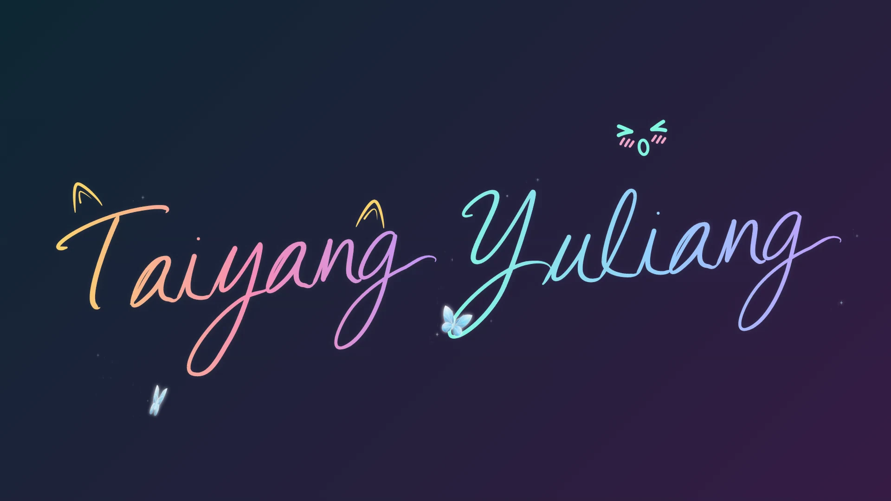

<div align="center">

  <h1>tyx · 签名动画</h1>
  <p><strong>把名字，写成自己的样子。</strong></p>
  <p>输入英文名字、拼音或字母缩写，设计会逐笔写出的签名，并在浏览器里导出 MP4。</p>

  <p>
    <a href="https://tangyx527.github.io/tyx-signature/"><strong>立即在线体验 ↗</strong></a>
    &nbsp; · &nbsp;
    <a href="assets/showcase/signature-demo.mp4?raw=true">查看情侣原画质 MP4</a>
  </p>

  <p>
    
    
    <a href="LICENSE"></a>
  </p>

  <picture>
    <source media="(prefers-reduced-motion: reduce)" srcset="assets/showcase/signature-poster.webp">
    
  </picture>

  <p><sub>情侣签名真实导出 · 完整 5 秒 · 1080p / 30 fps 原视频</sub></p>

</div>

## 快速开始

**直接打开[在线网站](https://tangyx527.github.io/tyx-signature/)，无需安装。**

1. **写下名字**：选择单人或情侣模式，输入英文名字、拼音或缩写。
2. **调整设计**：选择颜色与装饰，调整大小和笔迹粗细；开启“自由拖动”后直接移动构图。
3. **带走动画**：在“导出”中选择画幅、背景和时长，按需添加音乐；点击“生成”后会同时制作 MP4 与 GIF，再分别下载（GIF 不含音乐）。

配置自动保存在当前浏览器；右上角菜单支持下载和导入 JSON。设计与视频处理在当前设备完成，音频文件不包含在配置中，重新打开页面后需要重新选择。

## 核心功能

| 功能 | 可以做什么 |
| --- | --- |
| **TYX Brush 字形** | 项目内置的自有矢量连笔实现，保留输入大小写，包含起笔、连笔与收笔变化。 |
| **单人 / 情侣签名** | 两人同步书写，分别设置名字、颜色、大小、笔迹粗细、装饰及位置。 |
| **可爱装饰** | 萌宠、爪爪、表情与点缀四类图案，带有各自的小动作，可调整大小和位置。 |
| **实时预览** | 修改参数即时更新；支持播放、暂停和进度拖动，“完整展开”便于静态调整设计。 |
| **开头与收尾动画** | 光点入场衔接真实笔迹，完成后的签名变形成彩色笔片；也可关闭首尾动画。 |
| **背景音乐** | 选择音乐片段，调整起点、音量、淡入和淡出，与视频一同导出。 |
| **浏览器端 MP4** | H.264、30 fps，横屏 / 竖屏 / 方形 1080p，时长 3–15 秒，支持取消生成。 |
| **GIF 导出** | 与 MP4 相同的设计，长边不超过 720 像素、15 帧/秒、无限循环；不依赖视频编码能力，也不包含音乐。 |

## 真实效果

### 单人签名 · 轻巧的小表情

<picture>
  <source media="(prefers-reduced-motion: reduce)" srcset="assets/showcase/single-poster.webp">
  
</picture>

一份笔迹，加一点自己的表情。[查看单人原画质 MP4](assets/showcase/single-demo.mp4?raw=true)。

### 情侣签名 · 从书写到收尾

上方主视觉与下面的关键帧来自同一段情侣 MP4，展示 Taiyang / Yuliang、猫耳与太阳装饰，以及完整的书写与收尾。

| 逐笔写出 | 签名与装饰 | 彩色收尾 |
| :---: | :---: | :---: |
|  |  |  |

两段 GIF 均保留完整首尾；[情侣原画质 MP4](assets/showcase/signature-demo.mp4?raw=true)与单人原视频均为 1920 × 1080、30 fps、5 秒。系统偏好减少动态效果时，动画展示改用静态签名画面。

## 本地运行与部署

<details>
<summary><strong>开发者快速开始</strong></summary>

推荐 Node.js **24 LTS**，项目支持 `>=22.14 <25`。在源码目录执行：

```sh
npm ci
npm start
```

打开终端显示的网址。Windows 可双击 `开始使用.cmd`；macOS 可运行 `sh ./开始使用.command`。

构建静态网站：

```sh
npm run build
```

构建结果在 `dist/`，可部署到静态托管平台。使用 GitHub Pages 时，将仓库 Settings → Pages → Source 设为 **GitHub Actions**；随附工作流会在推送到 `main` 后自动检查、构建并部署。

常用命令：`npm run check` 检查类型，`npm test` 运行测试，`npm run preview` 预览构建结果。

</details>

## 技术架构

| 层次 | 技术与职责 |
| --- | --- |
| 编辑界面 | **React + TypeScript** 管理输入、双人设置、预览控制与配置保存。 |
| 图形与动画 | **Canvas** 绘制 TYX Brush 字形、装饰和首尾动画；预览与视频导出共用绘制器。 |
| 视频与音频 | 按需加载 **Mediabunny**，通过 **WebCodecs** 编码 H.264 MP4，可选 AAC 音轨。 |
| 构建与托管 | **Vite + GitHub Pages** 提供静态站点，不需要视频渲染后端。 |

## 兼容性

**网页能够打开，不代表当前设备一定能够导出视频。** 导出前，页面会检查所选画幅和编码能力。

- 需要 **HTTPS** 或本机 **localhost**，以及设备支持所选画幅的 H.264 [WebCodecs 编码](https://developer.mozilla.org/en-US/docs/Web/API/VideoEncoder)。
- 添加音乐还需要浏览器能够解码所选音频，并支持 AAC 编码；不支持时可尝试移除音乐或更换浏览器。
- 已在 **Windows 应用内浏览器**完成线上 1080p MP4 生成、下载与完整解码验证；手机宽度仅做过布局模拟。
- **iOS / Android 真机、macOS 本地启动，以及各浏览器与设备组合尚未逐一实测。** 请以页面检测结果为准，不承诺所有移动设备均可导出。

## 许可证

项目代码采用 [MIT](LICENSE)。React、Zod、Mediabunny、Geist 字体与 Phosphor 图标等资源保留各自许可，详见[第三方声明](THIRD_PARTY_NOTICES.md)。

项目的 MIT 声明不代表第三方资源或参考内容均采用 MIT，也不替代它们各自的权利与授权。

